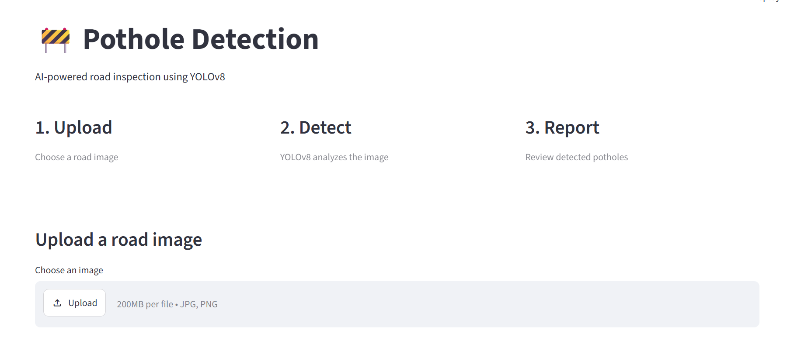
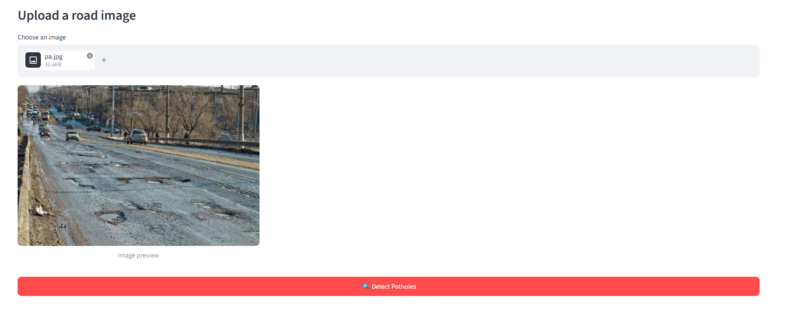
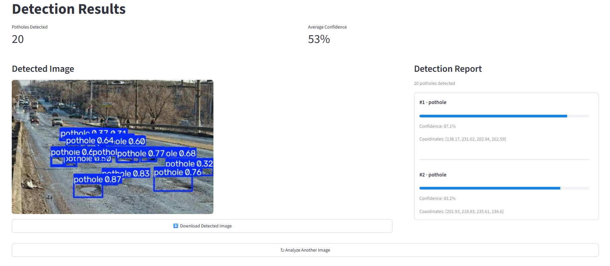

# 🚧 Pothole Detection using YOLOv8

An AI-powered pothole detection system using **YOLOv8**, **FastAPI**, and **Streamlit** to detect potholes from road images.

## ✨ Features

* Pothole detection using YOLOv8
* Bounding boxes and confidence scores
* Annotated image output
* Detection report
* FastAPI REST API
* Streamlit frontend

## 🛠️ Tech Stack

**Python | YOLOv8 | Ultralytics | FastAPI | Streamlit | Pillow | Requests**

## 📂 Project Structure

```text
Pathole_det/
├── model/
│   └── best.pt
├── backend/
│   ├── main.py
│   ├── predictor.py
│   └── __init__.py
├── frontend/
│   └── app.py
├── screenshots/
│   ├── home.png
│   ├── detection_result.png
│   └── detection_report.png
├── requirements.txt
├── .gitignore
└── README.md
```

## 🚀 Run Locally

### Install dependencies

```bash
pip install -r requirements.txt
```

### Start FastAPI

```bash
fastapi dev backend/main.py
```

### Start Streamlit

Open another terminal:

```bash
streamlit run frontend/app.py
```

## 📸 Screenshots

### Home / Upload



### Detection Result



### Detection Report



## 👩‍💻 Author

**Vaishnavi Parabkar**
